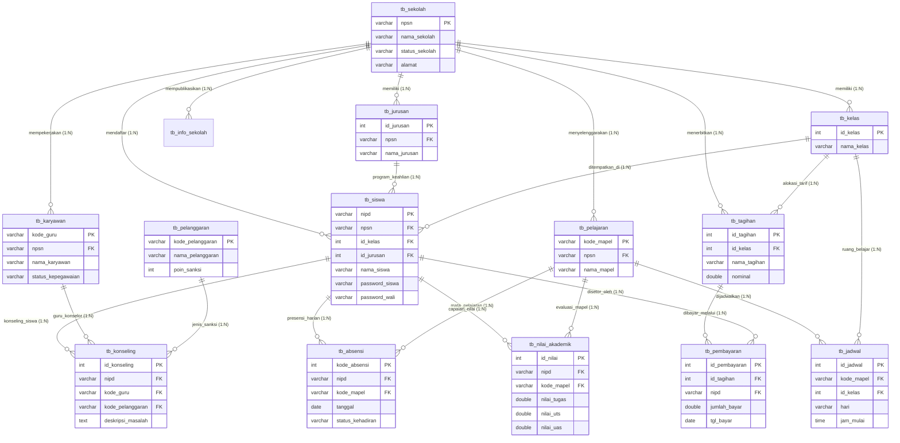

<p align="center">
  
</p>

<h1 align="center">Sistem Informasi Monitoring Akademik Sekolah (SIAKAD)</h1>

<p align="center">
  <strong>Platform Terpadu Pengelolaan Akademik, Absensi, Keuangan, Kedisiplinan, dan Monitoring Siswa Berbasis Web Multi-Peran</strong>
</p>

<p align="center">
  <a href="#fitur-utama"></a>
  <a href="#teknologi-dan-alat"></a>
  <a href="#teknologi-dan-alat"></a>
  <a href="#teknologi-dan-alat"></a>
  <a href="#profil-pengembang"></a>
</p>

---

## 📌 Daftar Isi
- [Tentang Proyek](#-tentang-proyek)
- [Hak Akses & Peran Pengguna (Multi-Role)](#-hak-akses--peran-pengguna-multi-role)
- [Dokumentasi Resmi & Publikasi Ilmiah](#-dokumentasi-resmi--publikasi-ilmiah)
- [Modul Fungsional Utama](#-modul-fungsional-utama)
- [Fitur Utama](#-fitur-utama)
- [Tangkapan Layar (Screenshots)](#-tangkapan-layar-screenshots)
- [Infrastruktur & Stack Teknis](#-infrastruktur--stack-teknis)
- [Struktur Direktori Proyek](#-struktur-direktori-proyek)
- [Panduan Instalasi & Konfigurasi](#-panduan-instalasi--konfigurasi)
- [Skema Basis Data & Diagram Relasi Entitas (ERD)](#-skema-basis-data--diagram-relasi-entitas-erd)
- [Profil Pengembang](#-profil-pengembang)
- [Lisensi](#-lisensi)

---

## 📖 Tentang Proyek

**Sistem Informasi Monitoring Akademik Sekolah (SIAKAD / SISMO)** adalah solusi sistem informasi manajemen sekolah komprehensif yang dirancang untuk mengintegrasikan proses operasional, pelaporan nilai akademik, pencatatan absensi real-time, pengelolaan tagihan/keuangan, hingga bimbingan konseling dan rekap pelanggaran tata tertib siswa.

Sistem ini menjembatani komunikasi transparan antara pihak sekolah, dewan guru, tata usaha, serta orang tua/wali murid untuk memastikan perkembangan belajar dan kedisiplinan peserta didik dapat dipantau kapan saja secara akurat.

---

## 👥 Hak Akses & Peran Pengguna (Multi-Role)

SIAKAD mendukung autentikasi cerdas multi-level dalam satu pintu login terpadu:

| Peran (Role) | Tanggung Jawab & Cakupan Akses |
|---|---|
| **Admin Utama** | Pengawasan sistem tingkat yayasan/pusat, manajemen sekolah, pendaftaran instansi, dan kontrol hak akses global. |
| **Admin Sekolah** | Manajemen master data sekolah (guru, karyawan, kelas, jurusan, mata pelajaran, jadwal, serta siswa). |
| **Kepala Sekolah** | Akses laporan eksekutif, rekapitulasi kehadiran, progres akademik, dan evaluasi operasional sekolah. |
| **Wali Kelas** | Pemantauan akademik kelas binaan, presensi/absensi harian, penilaian siswa, dan komunikasi intensif dengan wali murid. |
| **Guru BK (Bimbingan Konseling)** | Rekapitulasi poin pelanggaran, riwayat konseling, catatan kedisiplinan, dan pendampingan siswa bermasalah. |
| **Tata Usaha (TU)** | Tata kelola administrasi kepegawaian, verifikasi data induk siswa, serta manajemen tagihan dan pembayaran (SPP). |
| **Siswa** | Portal pribadi untuk cek jadwal pelajaran, progres kehadiran, transparansi nilai, dan status administrasi. |
| **Wali Murid** | Monitoring transparan perkembangan nilai anak, presensi harian di sekolah, histori pembayaran, dan riwayat kedisiplinan. |

---

## 📚 Dokumentasi Resmi & Publikasi Ilmiah


Tersedia paket dokumentasi teknis dan publikasi ilmiah lengkap di direktori `docs/`:

| Jenis Dokumen | Deskripsi Standar | Unduh Versi PDF | Versi Word (.doc) | Versi Markdown (.md) |
|---|---|:---:|:---:|:---:|
| **SRS Formal** | *Software Requirements Specification* (Standar IEEE Std 830 / ISO 29148) | [📄 Unduh PDF](docs/SRS_FORMAL_SIAKAD.pdf) | [📝 Unduh DOC](docs/SRS_FORMAL_SIAKAD.doc) | [📋 Baca MD](docs/SRS_FORMAL_SIAKAD.md) |
| **Jurnal Ilmiah** | Artikel Ilmiah: *Rancang Bangun SIAKAD Menggunakan Metode Waterfall* | [📄 Unduh PDF](docs/JURNAL_ILMIAH_SIAKAD.pdf) | [📝 Unduh DOC](docs/JURNAL_ILMIAH_SIAKAD.doc) | [📋 Baca MD](docs/JURNAL_ILMIAH_SIAKAD.md) |
| **Spesifikasi Modul (FSD)** | Dokumen Spesifikasi 10 Modul Fungsional & Matriks Hak Akses | [📄 Unduh PDF](docs/DOKUMENTASI_MODUL_FUNGSIONAL.pdf) | [📝 Unduh DOC](docs/DOKUMENTASI_MODUL_FUNGSIONAL.doc) | [📋 Baca MD](docs/MODUL_FUNGSIONAL.md) |
| **Kamus Data & DDL** | Spesifikasi Lengkap DDL, Tipe Data, PK/FK Constraints 16 Tabel | - | - | [📋 Baca MD](docs/DATABASE_DDL.md) |

---

## 📦 Modul Fungsional Utama

Sistem dirancang modular untuk mengakomodasi seluruh proses bisnis institusi pendidikan sekolah:

### 1. Modul Manajemen Master Data & Kelembagaan
- **Pengelolaan Lembaga**: Pendataan profil sekolah, identitas NPSN, visi-misi, serta informasi kontak resmi.
- **Data Ketenagaan**: Manajemen data guru, staf tata usaha, dan staf kependidikan beserta data status kepegawaian.
- **Rombongan Belajar & Jurusan**: Pengaturan struktur jurusan/keahlian, tingkatan kelas, dan pembagian ruang belajar.

### 2. Modul Data Induk Kesiswaan (Buku Induk Digital)
- **Registrasi & Verifikasi**: Pencatatan data lengkap siswa (biodata, NIPD, NISN, data orang tua/wali, alamat, dan kontak).
- **Penempatan Rombel**: Pemetaan siswa ke dalam rombongan belajar (kelas) serta pengelolaan riwayat kelas siswa.

### 3. Modul Kurikulum, Mata Pelajaran & Penjadwalan KBM
- **Katalog Mata Pelajaran**: Registrasi mata pelajaran per kurikulum dan jurusan.
- **Penjadwalan KBM Terintegrasi**: Pemetaan guru pengampu, kelas, hari, dan alokasi jam belajar untuk mencegah jadwal bentrok.

### 4. Modul Presensi & Rekapitulasi Kehadiran
- **Pencatatan Presensi Real-Time**: Input presensi kehadiran harian siswa (*Hadir, Izin, Sakit, Alpa*).
- **Monitoring Kehadiran Kelas**: Rekapitulasi persentase absensi bulanan dan semester untuk bahan evaluasi wali kelas dan kepala sekolah.

### 5. Modul Penilaian Akademik & Transparansi Nilai
- **Penginputan Komponen Nilai**: Pencatatan nilai tugas harian, Ujian Tengah Semester (UTS), dan Ujian Akhir Semester (UAS).
- **Rekap Hasil Belajar**: Kalkulasi otomatis nilai akhir mata pelajaran sebagai rujukan laporan capaian belajar siswa.
- **Cetak Lembar Rapor Digital (E-Rapor)**: Format standar cetak/PDF A4 rapi dan resmi lengkap dengan kop sekolah, identitas siswa, tabel capaian nilai & bobot, rekap kehadiran (S/I/A), catatan perkembangan wali kelas, serta 3 kolom pengesahan (Wali Murid, Wali Kelas, dan Kepala Sekolah).

### 6. Modul Keuangan, Tagihan & Pembayaran (Billing SPP)
- **Pengaturan Pos Tagihan**: Pembuatan tarif tagihan rutin (SPP bulanan) dan tagihan insidental pendidikan.
- **Pencatatan Transaksi Pembayaran**: Verifikasi pembayaran siswa, status pelunasan (*Lunas / Menunggak*), dan riwayat pembayaran.
- **Cetak Kuitansi Pembayaran (Kuitansi Kas Masuk)**: Bukti transaksi pembayaran resmi format cetak/PDF A5 landscape dengan nomor kuitansi otomatis, terbilang rupiah dinamis, rincian pembayaran, serta kolom tanda tangan kasir Tata Usaha.

### 7. Modul Bimbingan Konseling (BK) & Kedisiplinan Siswa
- **Buku Pelanggaran & Poin Sanksi**: Pencatatan jenis pelanggaran tata tertib beserta akumulasi poin sanksi siswa.
- **Catatan Konseling**: Dokumentasi rekam jejak bimbingan konseling dan rekomendasi tindak lanjut pembinaan siswa.

### 8. Modul Portal Mandiri Siswa & Monitoring Wali Murid
- **Dashboard Siswa**: Akses mandiri untuk melihat jadwal pelajaran aktif, rekap kehadiran diri, nilai akademik, dan status tagihan.
- **Parental Monitoring**: Portal khusus orang tua untuk memantau performa belajar anak, presensi harian di sekolah, serta catatan kedisiplinan secara transparan.

### 9. Modul Komunikasi Internal & Kotak Pesan
- **Layanan Pesan Internal**: Fasilitas pesan masuk, pesan keluar, dan obrolan langsung untuk memfasilitasi koordinasi antara wali kelas, orang tua murid, dan manajemen sekolah.

---

## 🚀 Fitur Utama

### 1. Manajemen Akademik & Kurikulum
- Pengelolaan master mata pelajaran, kelas, dan jurusan.
- Penjadwalan jadwal belajar mengajar otomatis per hari dan jam.
- Penginputan dan rekapitulasi nilai akademik siswa (tugas, UTS, UAS).
- Cetak lembar Rapor Capaian Belajar (E-Rapor) format A4 resmi dengan kop sekolah, rekap absensi, dan kolom tanda tangan pengesahan.

### 2. Presensi & Absensi Siswa
- Pencatatan kehadiran harian siswa secara berkala (Hadir, Sakit, Izin, Alpa).
- Laporan rekap absensi per kelas dan per periode untuk monitoring cepat.

### 3. Keuangan & Administrasi (SPP)
- Pembuatan pos tagihan sekolah per siswa atau per tingkatan kelas.
- Rekapitulasi pembayaran, validasi transaksi, dan cetak kuitansi resmi (format A5 landscape dengan terbilang rupiah dinamis).

### 4. Bimbingan Konseling (BK) & Kedisiplinan
- Pencatatan insiden pelanggaran siswa beserta bobot poin sanksi.
- Riwayat sesi konseling siswa terpadu untuk evaluasi pembinaan karakter.

### 5. Komunikasi & Olah Pesan
- Modul perpesanan internal antar peran untuk koordinasi cepat antar pihak sekolah dan wali murid.

---

## 📸 Tangkapan Layar (Screenshots)

Berikut beberapa dokumentasi antarmuka aplikasi:

| Halaman Login Terpadu | Portal Web Profil Sekolah |
|:---:|:---:|
|  |  |


| Profil Lengkap Siswa | Manajemen Jadwal & Mata Pelajaran |
|:---:|:---:|
|  |  |

| Rekapitulasi Presensi / Absensi | Form Pencatatan Presensi Harian |
|:---:|:---:|
|  |  |

| Form Penugasan & Jam Mengajar | Manajemen Kotak Masuk / Pesan |
|:---:|:---:|
|  |  |

---

## 💻 Infrastruktur & Stack Teknis

Sistem SIAKAD dirancang dengan arsitektur web berlapis yang efisien, berkecepatan tinggi, dan memiliki portabilitas tinggi agar mudah diimplementasikan baik pada jaringan intranet sekolah maupun cloud hosting:

### 1. Diagram Arsitektur Lapisan Sistem
```plaintext
┌────────────────────────────────────────────────────────────────────────┐
│                      ARSITEKTUR STACK TEKNIS SIAKAD                    │
├────────────────────────────────────────────────────────────────────────┤
│  Client Layer      : Web Browser (Chrome, Firefox, Edge, Safari)       │
│  Presentation/UI   : HTML5, CSS3, Bootstrap 3 (Miminium), jQuery      │
│  Application Layer : Native PHP (PHP 7.0 - 7.4 / 5.6+ with MySQLi)     │
│  Database Layer    : MySQL 5.7+ / MariaDB 10.3+ (Engine: InnoDB)       │
│  Web Server        : Apache HTTP Server 2.4+ (dengan mod_rewrite)      │
│  OS Target         : Windows Server / Linux (Ubuntu/Debian/CentOS)     │
└────────────────────────────────────────────────────────────────────────┘
```

### 2. Komponen Perangkat Lunak (Software Stack)
- **Runtime Backend**: Native PHP (Kompatibel PHP 5.6 hingga PHP 7.x).
  - Ekstensi wajib: `mysqli` (database), `session` (autentikasi), `fileinfo` & `gd` (pemrosesan foto profil siswa/guru).
- **Database Management System (DBMS)**: MySQL 5.7+ / MariaDB 10.3+ (Karakter set: `utf8mb4_general_ci`).
- **Web Server Engine**: Apache HTTP Server 2.4+ (mendukung modul `mod_rewrite` dan berkas `.htaccess`).
- **Frontend Framework & UI Components**:
  - Bootstrap 3.3.7 Dashboard Framework (Miminium Theme).
  - Iconography: FontAwesome 4.x & Simple Line Icons.
  - UI Animation: Animate.css.
  - Client-side Libraries: jQuery 2.1.4, jQuery UI, Moment.js, dan iCheck plugin.

### 3. Kebutuhan Perangkat Keras (Hardware Requirements)

| Komponen Hardware | Spesifikasi Minimum (≤ 500 Siswa) | Rekomendasi Ideal (> 1.000 Siswa) |
|---|---|---|
| **Processor / CPU** | Dual-Core 2.0 GHz (atau 1 vCPU Cloud) | Quad-Core 2.5 GHz ke atas (atau 2-4 vCPU) |
| **RAM (Memory)** | 2 GB DDR3/DDR4 | 4 GB - 8 GB DDR4 |
| **Penyimpanan (Disk)** | 20 GB HDD/SSD (Arsip database & berkas) | 50 GB - 100 GB SSD NVMe (Arsip & Backup) |
| **Bandwidth / Jaringan** | LAN 100 Mbps (Lokal) / Internet 5 Mbps | LAN Gigabit 1000 Mbps / Internet 20-50 Mbps |

### 4. Pilihan Model Deployment
- **Model 1: Intranet Sekolah (On-Premise / Offline)**
  - Sistem di-deploy pada server fisik lokal di sekolah menggunakan XAMPP atau Linux Server.
  - Seluruh guru, staf TU, dan siswa mengakses via LAN / WiFi sekolah tanpa membutuhkan kuota internet.
- **Model 2: Cloud / Web Hosting (Online 24/7)**
  - Sistem di-hosting pada Shared Hosting cPanel atau Cloud VPS (seperti DigitalOcean, AWS, IDCloudHost).
  - Orang tua/wali murid dapat memantau presensi dan nilai anak dari rumah kapan saja secara real-time.

---

## 📂 Struktur Direktori Proyek

```plaintext
siakad/
├── Index.php                    # Gerbang utama login terpadu
├── admin_sekolah/               # Modul manajemen utama sekolah (TU/Operator)
│   ├── asset/                   # Aset CSS, JS, dan Gambar modul
│   ├── proses/                  # Script pemrosesan data (koneksi, login, CRUD)
│   └── *.php                    # Tampilan halaman data, form, dan laporan
├── admin_utama/                 # Modul kontrol sistem / super administrator
├── bk/                          # Modul Bimbingan Konseling & tata tertib
├── kepala_sekolah/              # Modul monitoring & dashboard eksekutif
├── siswa/                       # Portal mandiri siswa (jadwal, nilai, absensi)
├── tata_usaha/                  # Modul administrasi & tagihan/keuangan SPP
├── wali_kelas/                  # Modul absensi kelas & rapor nilai kelas
├── wali_murid/                  # Portal monitoring perkembangan belajar anak
├── database/                    # Skrip DDL database SQL (sismo_smkit.sql)
├── docs/                        # Dokumentasi Resmi (SRS, Jurnal Ilmiah, FSD: .pdf, .doc, .md)
└── asset/                       # Vendor CSS, Fonts, Icons, dan Javascript
```

---

## ⚙️ Panduan Instalasi & Konfigurasi

Ikuti langkah-langkah di bawah ini untuk menjalankan sistem di lingkungan lokal:

### 1. Prasyarat Sistem
- Web Server lokal seperti **XAMPP**, **Laragon**, atau **WampServer** (dengan dukungan PHP 7.x).
- Web Browser modern (Chrome, Edge, Firefox).

### 2. Pemasangan Berkas
Clone atau salin repositori proyek ke direktori web server lokal:
```bash
# Jika menggunakan XAMPP (Windows):
cd C:/xampp/htdocs/
git clone <url-repository> siakad
```

### 3. Konfigurasi Basis Data & Eksekusi DDL

Pilih salah satu metode pembuatan basis data di bawah ini:

#### Metode A: Melalui Command Line Interface (CLI - Cepat)
```bash
# Buat database jika belum ada
mysql -u root -p -e "CREATE DATABASE IF NOT EXISTS sismo_smkit;"

# Impor struktur DDL dan data awal
mysql -u root -p sismo_smkit < database/sismo_smkit.sql

# (Opsional) Pasang Stored Functions & Triggers untuk otomasi hitung nilai akhir & status SPP
mysql -u root -p sismo_smkit < database/triggers_and_functions.sql
```

#### Metode B: Melalui antarmuka phpMyAdmin
1. Buka browser dan arahkan ke **phpMyAdmin** (`http://localhost/phpmyadmin`).
2. Buat basis data baru bernama `sismo_smkit`.
3. Buka tab **Import** dan pilih berkas SQL dari direktori:
   ```
   siakad/database/sismo_smkit.sql
   ```
4. Klik tombol **Go / Import** hingga seluruh tabel berhasil dimuat.

> 📖 **Kamus Data & Spesifikasi DDL:** Rincian struktur kolom, tipe data, serta constraints kunci tamu (*Foreign Keys*) ke-16 tabel dapat dilihat di [docs/DATABASE_DDL.md](docs/DATABASE_DDL.md).

### 4. Konfigurasi Koneksi PHP
Periksa berkas konfigurasi koneksi di:
`admin_sekolah/proses/koneksi.php`

Pastikan kredensial database sesuai dengan konfigurasi web server lokal Anda:
```php
<?php
$conn = new mysqli("localhost", "root", "", "sismo_smkit");

if ($conn->connect_error) {
    die("Koneksi database gagal: " . $conn->connect_error);
}
?>
```

### 5. Menjalankan Aplikasi
Buka web browser dan akses URL berikut:
```
http://localhost/siakad/
```

---

## 🗄️ Skema Basis Data & Diagram Relasi Entitas (ERD)

Sistem ini didukung oleh basis data relasional `sismo_smkit` yang terintegrasi secara modular dengan isolasi data antar-instansi berbasis NPSN:

### 1. Diagram Relasi Entitas (Entity-Relationship Diagram / ERD)



### 2. Kamus Entitas & Relasi Data
- `tb_admin`: Kredensial dan profil administrator utama tingkat yayasan/pusat.
- `tb_sekolah`: Informasi identitas institusi sekolah dan NPSN (induk relasi tenant).
- `tb_karyawan`: Data guru, staf tata usaha, kepala sekolah, dan konselor BK.
- `tb_siswa`: Data induk siswa lengkap beserta NIPD dan akun wali murid.
- `tb_kelas` & `tb_jurusan`: Master data tingkatan kelas dan kompetensi keahlian.
- `tb_pelajaran` & `tb_jadwal`: Data mata pelajaran dan penjadwalan ruang/jam.
- `tb_absensi`: Rekam jejak presensi kehadiran siswa per tanggal.
- `tb_nilai_akademik`: Evaluasi hasil belajar siswa per mata pelajaran (Tugas, UTS, UAS).
- `tb_tagihan` & `tb_pembayaran`: Pos tagihan biaya pendidikan dan histori transaksi kasir.
- `tb_konseling` & `tb_pelanggaran`: Buku catatan bimbingan konseling dan sanksi poin siswa.
- `tb_pesan`: Modul komunikasi pesan masuk/keluar antar pengguna.

---

## 👨‍💻 Profil Pengembang

Proyek ini dikembangkan dan dirancang oleh:

<div align="left">
  <table>
    <tr>
      <td width="150" align="center">
        
      </td>
      <td>
        <strong>Bagus Budi Satoto</strong><br/>
        <em>Role: Web Developer</em><br/>
        Fokus pada perancangan arsitektur sistem informasi berbasis web, integrasi basis data, dan optimalisasi sistem manajemen institusi pendidikan.
      </td>
    </tr>
  </table>
</div>

---

## 📄 Lisensi

Proyek ini dikembangkan untuk kebutuhan manajemen institusi sekolah dan peningkatan transparansi monitoring akademik. Hak cipta dilindungi dan didistribusikan sesuai ketentuan internal pengembang.


[def]: ttps://user-images.githubusercontent.com/55027286/65805969-cc074400-e1b2-11e9-9f20-4f723acb3979.pn